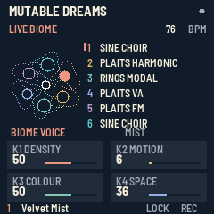

# Mutable Dreams 1.0

Six voices. Small worlds, endlessly unfolding.

An independent, free, open-source instrument for the **M-VAVE FM-1**, by **Kid Bunka / Christoph Link**, with gratitude to Émilie Gillet and Mutable Instruments. The combined program is additionally available under **GPL-3.0-only**; original component notices and earlier MIT rights are preserved. See [licensing details](LICENSING-GPL.txt).

[Play in your browser & edit patches](https://mutable-dreams.sugarypixie10.chatgpt.site/#editor) · [Firmware release](https://github.com/kidbee85-beep/mutable-dreams/releases/tag/v1.0) · [English tutorial](https://www.youtube.com/watch?v=PP6dAPAhIrQ) · [Install / update / return to stock](https://mutable-dreams.sugarypixie10.chatgpt.site/Mutable-Dreams-Installer.html)

- Six freely assignable tracks across eight engines: selected Plaits drums, FM, VA and harmonic synthesis; Rings modal resonator; custom Choir.
- 64 editable Biomes plus Blank, and 128 sound presets.
- Euclidean rhythm, probability, swing, accents, repeats and shared scales.
- Per-track filters, envelopes and granular sends; freeze, reverse and transpose the cloud.
- Four live macros, animated display, optional startup sound and contextual held-button help.
- Browser instrument running the actual firmware engine, with keyboard play and patch import/export. Browser edits stay local and do not upload patches to hardware.

## Downloads and complete source

- [Firmware 1.0](https://github.com/kidbee85-beep/mutable-dreams/releases/download/v1.0/Mutable-Dreams-1.0.fwsc)
- [Complete GPL source archive](https://github.com/kidbee85-beep/mutable-dreams/releases/download/v1.0/Mutable-Dreams-1.0-GPL-Source.zip) — app, selected upstream engines, platform/BSP, build tools, tests and original notices.
- [Source archive in this repository](Mutable-Dreams-1.0-GPL-Source.zip)
- [Full original release package](https://github.com/kidbee85-beep/mutable-dreams/releases/download/v1.0/Mutable-Dreams-Release.zip)
- [GPL distribution notice](https://github.com/kidbee85-beep/mutable-dreams/releases/download/v1.0/Mutable-Dreams-1.0-GPL-Notice.txt)
- [Quickstart](Quickstart.txt), [Recovery guide](Recovery-Guide.txt), [Measured validation](VALIDATION.md)

This is a distribution repository. **Extract the named GPL source ZIP for the complete buildable source tree.** GitHub's automatic source archives contain this repository, including the named complete-source archives. Inside the GPL archive, `README.md` documents device, host and WebAssembly builds; `SOURCE-SHA256.txt` fingerprints every source file. Python 3.11+, Pillow and a C/C++ compiler are required; device builds also require the external JieLi pi32v2 compiler and AC79 SDK, and web builds use WASI SDK 34.0. No CI-built badge is claimed.

The original MIT/MPL source archive remains available as historical material. The additional GPL source differs only in licence metadata and documentation; it changes no audio or control behaviour. **No firmware asset or existing checksum has been replaced.**

Firmware identity: `FM-1_710010000`  
Firmware SHA-256: `75008881683cbeb3515e24cfd7830136b90eb293f0752dc66b203b7f2ee7cd9f`

## Validation and limits

The exact release passed physical FM-1 installation, 19 stress cases, 6 FULL/ECO boundaries, all 65 Biomes, 128 sound recalls, granular size checks, a ten-minute soak, saved-state persistence and a return to original V15 followed by reinstallation. Zero measured audio faults in that suite. Dense combinations automatically enter ECO; not every six-voice combination supports FULL. See the validation report for scope and limits. One personal hardware save slot; browser files allow multiple patches. Granular audio is not saved.

## For The Firmware Hub

[FIRMWARE-HUB.json](FIRMWARE-HUB.json) contains the author, description, exact firmware/source URLs and hashes, installer, tutorial, image and validation links. The `.fwsc` contains the update loader. Hub acceptance and its installer integration are determined by the maintainer; this repository does not claim an existing listing.

Native 240×240 firmware display captures: [Live](Screen-Live.png), [Sound](Screen-Sound.png), [Filter](Screen-Filter.png), [Rhythm](Screen-Rhythm.png), [Granular](Screen-Grain.png), [Help](Screen-Help.png). These are actual rendered firmware screens, not hardware photographs.

## With gratitude

Émilie Gillet and Mutable Instruments' original Plaits, Rings and stmlib MIT credits remain intact. fm1-base by Charles Vestal and felucca-bsp / Felucca work by Leo Kuroshita and contributors retain MPL-2.0 rights, additionally distributed with the GPL application under MPL section 3.3. Fonts retain OFL notices; SDK-derived material retains its Apache notices. See the complete source archive and [licensing addendum](LICENSING-GPL.txt).

Independent community project, neither affiliated with nor endorsed by Mutable Instruments nor M-VAVE. Selected algorithms, not complete module ports; the granular bus and Choir are our own designs.
