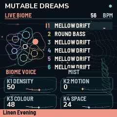

# Mutable Dreams 1.1

Six voices. Small worlds, endlessly unfolding.

Thank you for the music, questions and community feedback that shaped this update. **Mutable Dreams**, by **Kid Bunka / Christoph Link**, is a free, independent instrument for the **M-VAVE FM-1**, with deep gratitude to **Émilie Gillet and Mutable Instruments**.

[Play & edit in your browser](https://mutable-dreams.sugarypixie10.chatgpt.site/#editor) · [Download 1.1](https://github.com/kidbee85-beep/mutable-dreams/releases/tag/v1.1) · [Watch the update](https://www.youtube.com/watch?v=RCgs8t8fXvM) · [Install / update / return](https://mutable-dreams.sugarypixie10.chatgpt.site/Mutable-Dreams-1.1-Install.html)

## Warmer worlds, your own Biomes

- Six freely assignable tracks and **12 engines**. New Round Bass, Elements Strike, Mellow Drift and Satin Morph complement selected original Plaits/Rings voices and custom engines.
- **224 factory tones**, **76 musical Biomes + Blank**, **16 named User Biomes** and **64 User Sound slots**.
- Global mixer with level and granular/delay/room sends. Shared effects, bassline modes, glide and editable **16-step phrases** with notes, rests, accents and probability.
- Original Marbles-inspired remembered variation, Tides-inspired cyclic modulation and Warps-inspired ring blending. Selected functions, not complete module ports.
- Live bidirectional browser editor, JSON live-patch transfer and complete `.mddb` saved-bank backup/restore. The standalone browser instrument runs the same application/DSP source, with separate local storage.
- USB and TRS MIDI input, external clock, nineteen organic animated pages and held-button help. **USB tested; physical TRS cable test outstanding.** No MPE, MIDI output or live MIDI recording.

[All update notes](Update-Notes-1.1.txt) · [Quickstart](Quickstart-1.1.txt) · [Measured validation](Validation-1.1.txt)

## Update and keep your work

**Direct update from Mutable Dreams 1.0 is supported and tested on the exact release binary.** Stock V15 is not required between 1.0 and 1.1. Installation from original V15 and return to V15 are documented in the [1.1 recovery guide](Recovery-1.1.txt).

Use the backup procedure for your current version. **1.0 does not support the new `.mddb` protocol.** On 1.1, keep `.mddb` for saved data and JSON for unsaved live edits. Returning to V15 erases 1.1 User Banks/preferences. Save while stopped with the internal clock. Full-bank restore requires physical **SEL** confirmation.

The [published v1.0 release](https://github.com/kidbee85-beep/mutable-dreams/releases/tag/v1.0), its tag and original assets remain unchanged. [Original 1.0 documentation](README-1.0.md).

## Complete corresponding source

Download [Mutable-Dreams-1.1-Source.zip](Mutable-Dreams-1.1-Source.zip) for the complete buildable app, selected upstream DSP, platform/BSP, tools, tests and original notices. This remains a **distribution repository**: GitHub's automatic source download contains this repository; extract the named source ZIP to build the firmware. The combined distribution is **GPL-3.0-only** with original MIT/MPL-2.0 and font notices retained. See [licensing](LICENSING-GPL.txt).

The archive README documents host/device/WASM builds. Python 3.11+, Pillow and a C/C++ compiler are required; device builds also need the external JieLi pi32v2 compiler and AC79 SDK, while web builds use WASI SDK 34.0. No CI-built badge is claimed.

Firmware identity: `FM-1_710010100`  
Firmware SHA-256: `8e039bb0e9681fbbb0504e9b7d251895958fd88ae97f11ff0342b4aef38143d2`

The [qualification report](Validation-1.1.txt) distinguishes exact-final-file tests, inherited V15/cold-start evidence, owner-confirmed browser checks and untested physical TRS. Dense final playback cases had zero new audio faults, with peaks of 84.67% and 79.60% of the callback budget. A stopped flash restoration produced one separately recorded timing event. Saving is not seamless playback-time writing. No claim covers every possible patch or every third-party firmware route.

## For The Firmware Hub

[FIRMWARE-HUB.json](FIRMWARE-HUB.json) supplies exact firmware/source URLs, hashes, author, categories, screenshots, installer, recovery and tutorial. Use the named complete source archive. Listing acceptance and integration are the maintainer's decision.

Native firmware renders: [Live](Screen-1.1-Live.png), [Sound](Screen-1.1-Sound.png), [Mixer](Screen-1.1-Mixer.png), [Grain](Screen-1.1-Grain.png), [Phrase](Screen-1.1-Phrase.png), [Banks](Screen-1.1-Banks.png). These are rendered firmware screens, not camera photographs.

## With gratitude

Émilie Gillet / Mutable Instruments; Charles Vestal / fm1-base; Leo Kuroshita / Felucca; and the open-source contributors. Original component rights and notices are preserved. No JIANT or OberVave implementation was copied. Independent community project, unaffiliated with and not endorsed by Mutable Instruments or M-VAVE.
